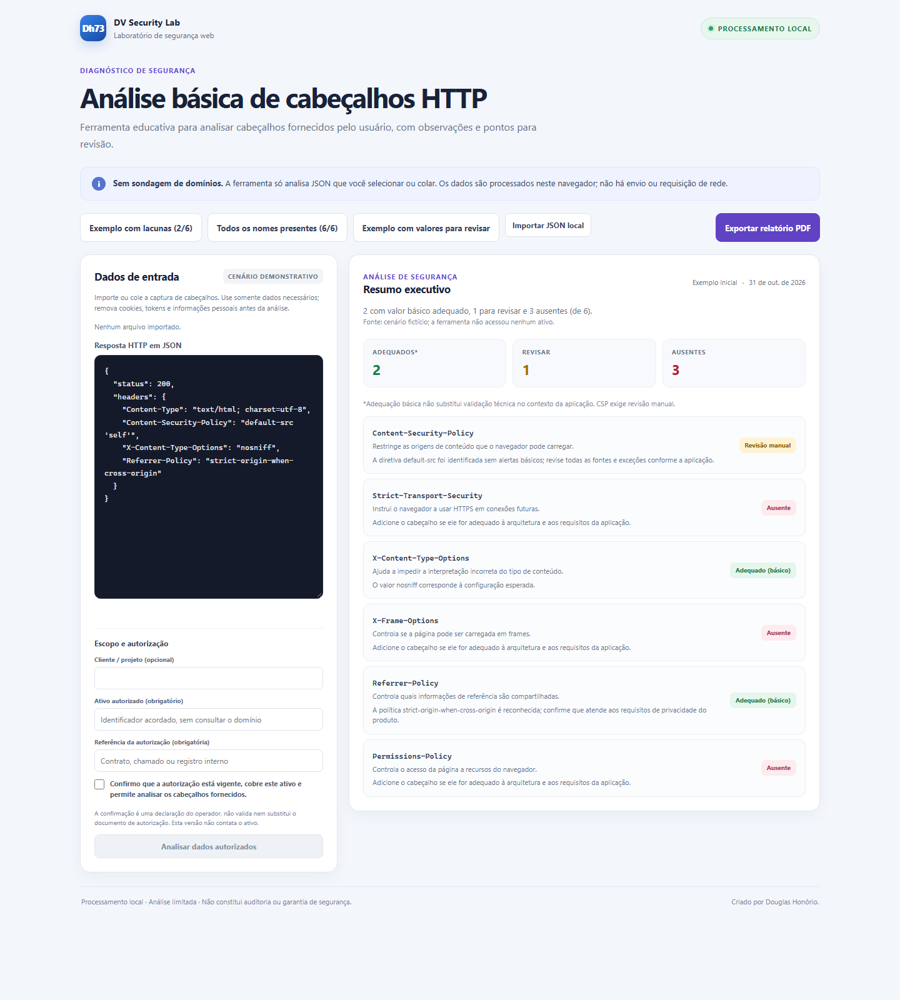

# Dh73 Security Lab

Ferramenta educativa para análise básica de cabeçalhos HTTP fornecidos pelo usuário. Os dados são processados localmente; o projeto não consulta sites e não substitui uma auditoria de segurança.

## Demonstração do simulador

Interface local com resumo executivo, recomendações e exportação para PDF. Todos os cenários usam dados fictícios:



## Tecnologias utilizadas

- **Python 3.10+** — verificador de cabeçalhos e geração do relatório HTML usando a biblioteca padrão.
- **HTML5, CSS3 e JavaScript** — simulador interativo executado localmente no navegador.
- **JSON** — formato dos dados de entrada e dos exemplos.
- **`unittest`** — testes automatizados do verificador Python.
- **GitHub Actions (YAML)** — execução dos testes automatizados em pushes e pull requests.

## Direitos de uso

Este projeto não é distribuído sob uma licença de código aberto. Todos os direitos são reservados por Douglas Honório. A visualização do repositório não concede permissão para copiar, modificar, redistribuir ou comercializar o projeto. Para solicitar autorização, entre em contato com o autor. Consulte o arquivo [LICENSE](./LICENSE).

## Análise básica de cabeçalhos HTTP

O verificador Python analisa um arquivo JSON local e informa quais nomes de cabeçalhos recomendados estão presentes ou ausentes. O simulador no navegador também oferece verificações heurísticas educativas de alguns valores e recomenda revisão manual. As análises são limitadas e não demonstram que um site esteja seguro.

Cabeçalhos analisados:

- `Content-Security-Policy`
- `Strict-Transport-Security`
- `X-Content-Type-Options`
- `X-Frame-Options`
- `Referrer-Policy`
- `Permissions-Policy`

## Requisitos

- Python 3.10 ou superior.

## Executar

No PowerShell, a partir da pasta do projeto:

```powershell
python .\01-verificador-headers\checker.py .\01-verificador-headers\examples\response.json
```

## Ver resultado visualmente

Para demonstrar, abra `01-verificador-headers\simulador.html` no navegador e selecione um cenário. Para analisar cabeçalhos fornecidos pelo usuário, importe um JSON local de até 1 MiB ou cole os dados, informe o ativo e a referência da autorização, confirme o escopo e clique em **Analisar dados autorizados**. O resumo e a lista são gerados no navegador; nenhum domínio é consultado. Use **Exportar relatório PDF** para imprimir ou salvar o resultado.

O JSON deve conter um objeto `headers`; use o [exemplo de resposta](./01-verificador-headers/examples/response.json) como modelo.

As verificações de valor são intencionalmente limitadas: não avaliam a política completa nem confirmam que um site esteja seguro. O comando Python e o relatório HTML estático verificam somente a presença dos nomes dos cabeçalhos.

O fluxo requer declaração do operador, mas não verifica documentos ou titularidade. Remova cookies, tokens, credenciais e dados pessoais antes de fornecer um JSON. Leia o [Guia Operacional](./GUIA-OPERACIONAL.md) sobre escopo, autorização, privacidade, validação, implantação e suporte. Este protótipo é para demonstração e piloto local controlado; não está aprovado para venda como auditoria ou serviço de segurança em produção.

Gere um relatório HTML a partir dos mesmos dados simulados:

```powershell
python .\01-verificador-headers\checker.py .\01-verificador-headers\examples\response.json --html .\relatorio-headers.html
```

Abra `relatorio-headers.html` no navegador ou pelo VS Code. O relatório destaca cada cabeçalho como presente ou ausente e não faz conexões de rede.

## Rodar os testes

```powershell
python -m unittest discover -s .\01-verificador-headers\tests -t .\01-verificador-headers -v
```

Os testes usam apenas respostas simuladas e a biblioteca padrão do Python; não é necessário instalar dependências.
